<p align="center">
  
</p>

<h1 align="center">Next Stop</h1>

<p align="center">
  <b>Live Chicago trains (Metra and the CTA 'L') on a fast, phone-friendly board and map that you host yourself.</b><br>
  <sub>Uses Metra's and CTA's public data. Not sponsored, affiliated, or operated by Metra or CTA.</sub>
</p>

<p align="center">
  <a href="#install-on-unraid">Install</a> ·
  <a href="#features">Features</a> ·
  <a href="#configuration">Configuration</a> ·
  <a href="#home-assistant-morning-train-notification">Home Assistant</a> ·
  <a href="#api">API</a>
</p>

Next Stop is a self-hosted web app. It runs in Docker on a home server (an Unraid template is included), and you open it in a browser on any phone, tablet or computer on your network at `http://<your-server-ip>:8080`. Add it to your home screen and it works like an app.

## See it in action

<table>
  <tr>
    <td align="center" width="50%">
      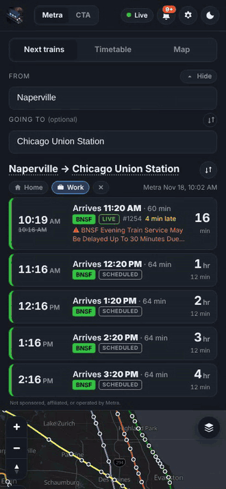<br>
      <b>Metra</b>: board → a train's stops → map → one line → its timetable<br>
      <sub><a href="docs/media/demo-metra.mp4">MP4</a></sub>
    </td>
    <td align="center" width="50%">
      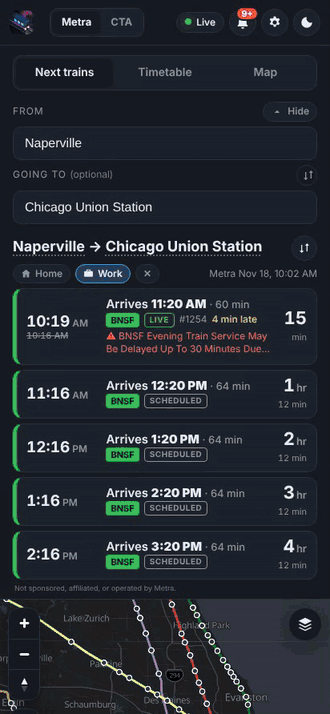<br>
      <b>CTA 'L'</b>: arrivals at Clark/Lake → every train on the map → the Red Line<br>
      <sub><a href="docs/media/demo-cta.mp4">MP4</a></sub>
    </td>
  </tr>
</table>

## Screenshots

Phone screenshots are full-screen at 1080 × 2340 (a Galaxy S25 Ultra).

<table>
  <tr>
    <td align="center">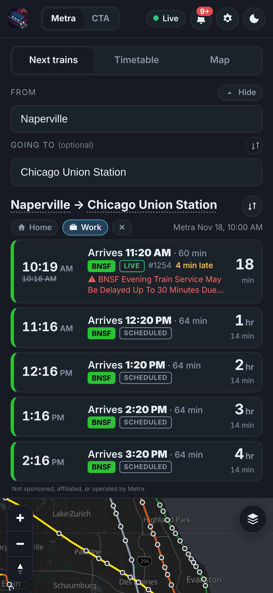<br><b>Next trains</b><br><sub>Live delays, reasons, minutes until</sub></td>
    <td align="center">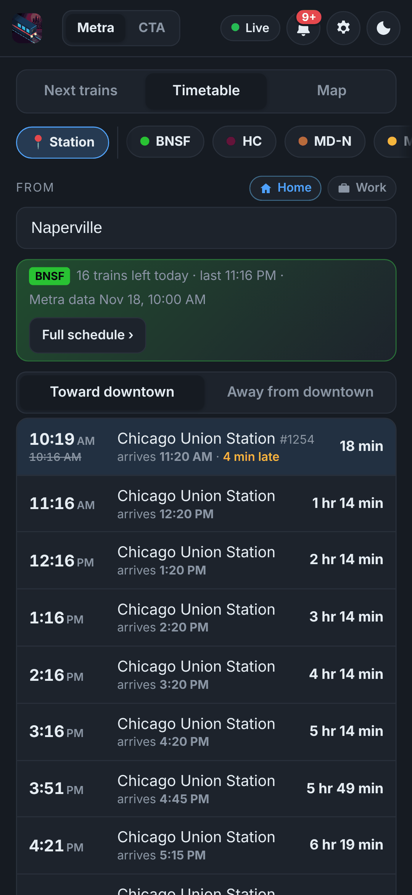<br><b>Timetable</b><br><sub>Trains on the way now and the rest of today</sub></td>
    <td align="center">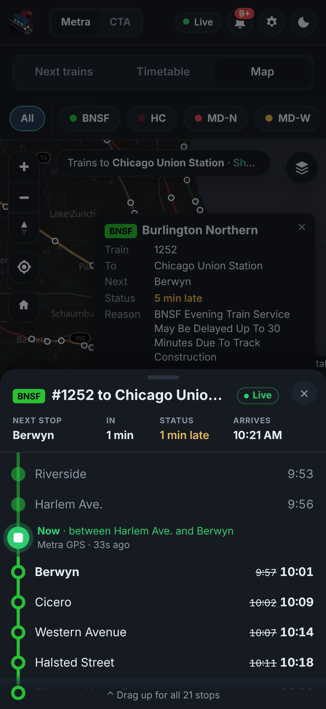<br><b>Follow a train</b><br><sub>Where it is, every stop, live times</sub></td>
  </tr>
  <tr>
    <td align="center">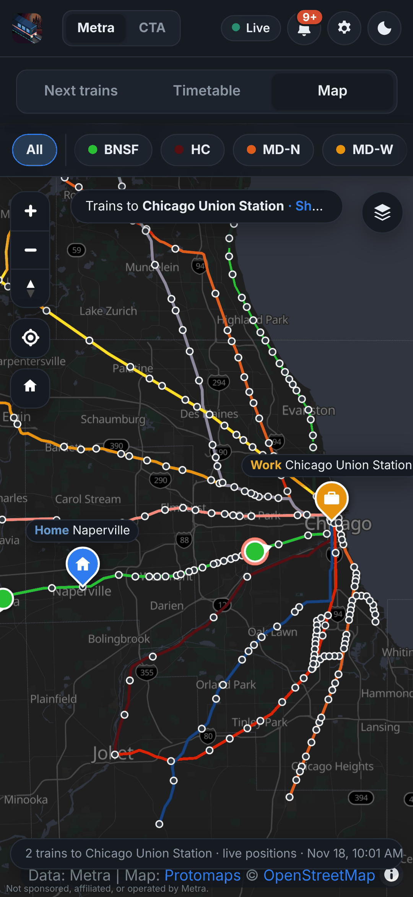<br><b>Your commute</b><br><sub>The map opens on home and work</sub></td>
    <td align="center">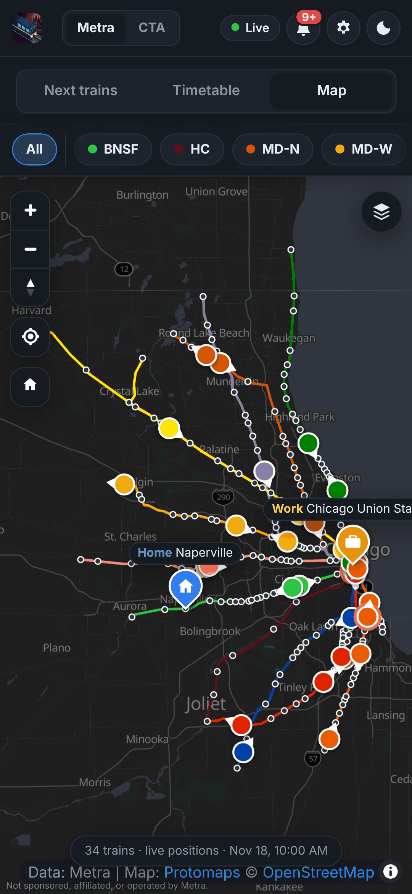<br><b>Every train</b><br><sub>Official line colors, live positions</sub></td>
    <td align="center">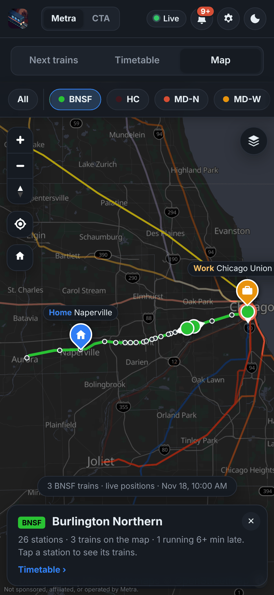<br><b>One line</b><br><sub>Its stations and trains, one tap to its timetable</sub></td>
  </tr>
  <tr>
    <td align="center">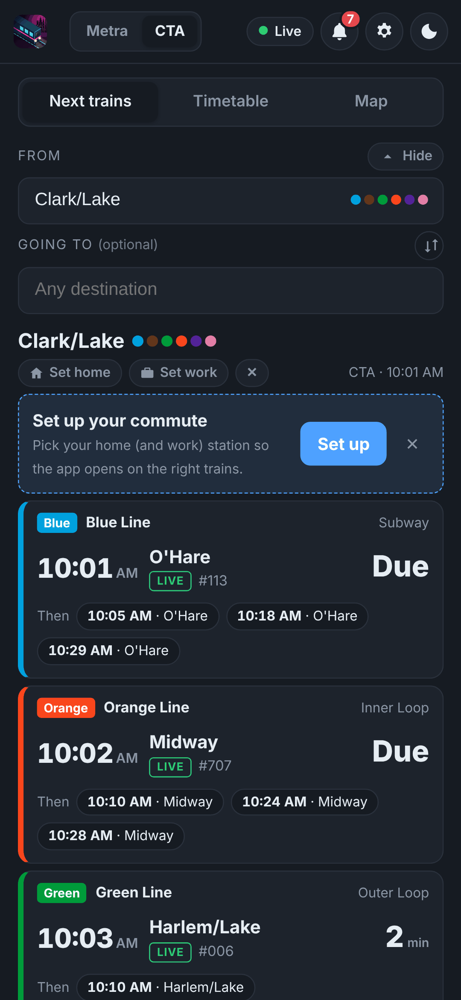<br><b>CTA arrivals</b><br><sub>Every line at a station, live from Train Tracker</sub></td>
    <td align="center">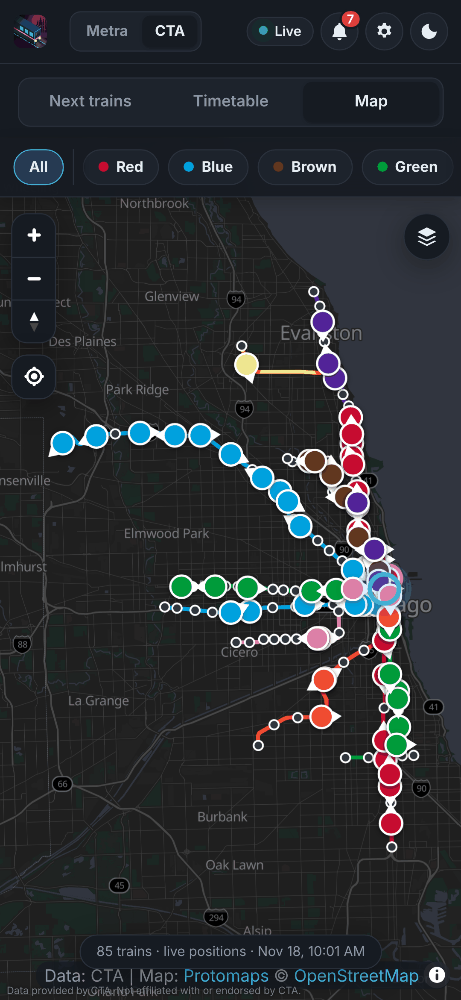<br><b>The 'L' map</b><br><sub>All trains, every 30 seconds</sub></td>
    <td align="center">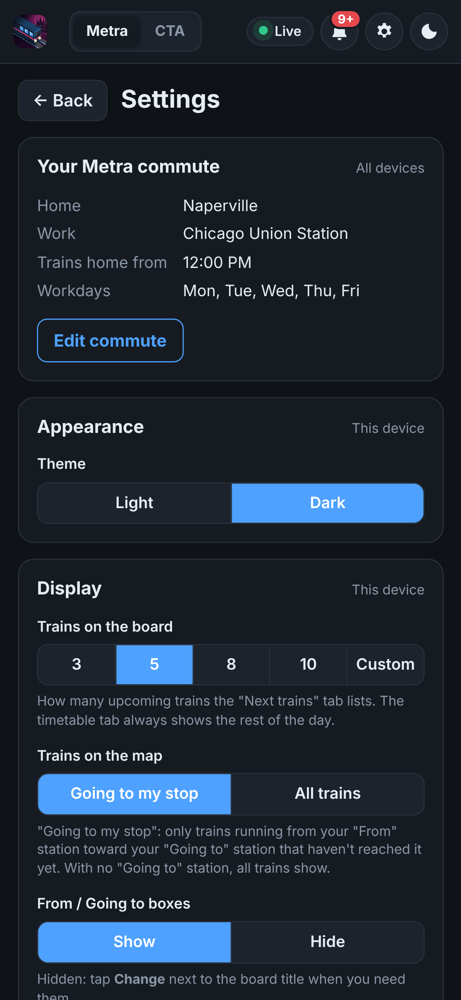<br><b>Settings</b><br><sub>Commute, theme, trains on the board</sub></td>
  </tr>
</table>

<details>
<summary><b>Desktop</b> (dark and light)</summary>

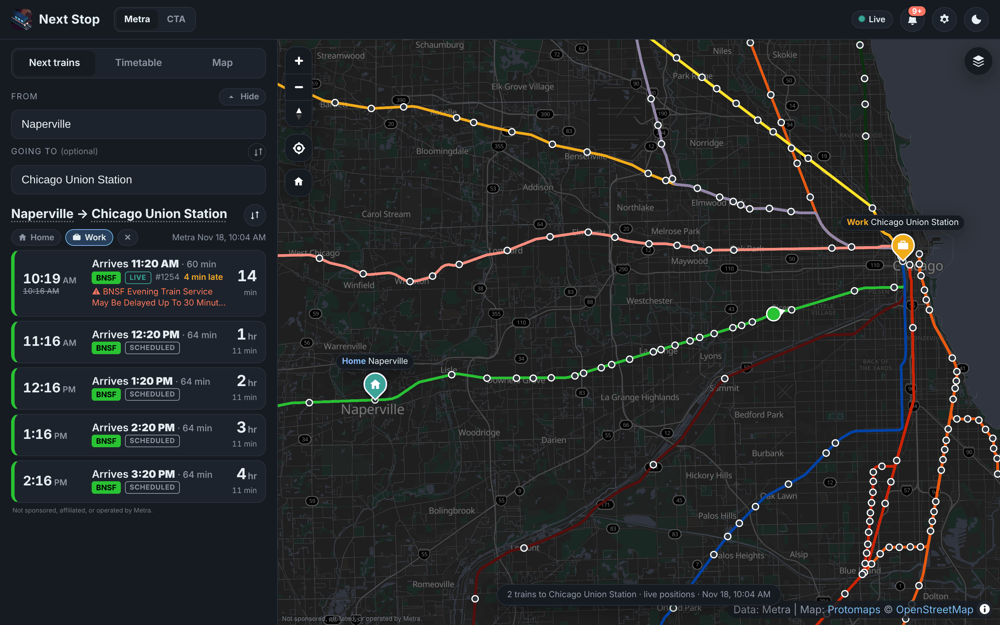
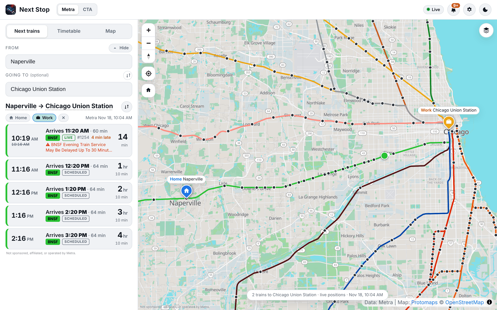

</details>

<details>
<summary><b>Light mode on a phone</b></summary>

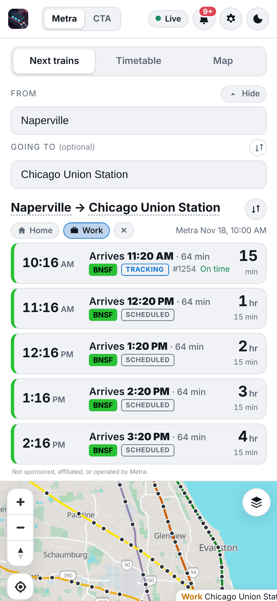

</details>

## What it does

- **When's my next train, and is it on time?** Live departures with delays, the reason when Metra posts one, and minutes until it leaves.
- **Where is it right now?** A live map of every Metra and CTA 'L' train, and a stop-by-stop view of any one train.
- **What's left today?** The day's remaining trains from your station, plus a line's full printed-style timetable.
- **Opens on your commute.** Set home and work once: mornings open on the trip to work, afternoons on the trip home, on every device.
- **Tells you when something's wrong.** Service alerts behind a 🔔 bell, with timetable-changing ones flagged.
- **Knows how reliable your train is.** A year of history gives each train an on-time record at your station.
- **Light on your data.** Your phone only downloads small summaries from your server, never from Metra or CTA.

## Features

### Next trains (Metra)

- **The board.** The next 3, 5, 8 or 10 trains (or any number up to 50) with time, minutes until (or hours and minutes), destination, line and train number.
- **No destination?** One card per line and direction: the next train big, the following ones small. Tap one to see every train on that line.
- **With a "Going to" station.** Only trains that stop there, each with its arrival time and trip length. Every train also shows its estimated arrival at the end of the line.
- **Status badges.**
  - **Live**: Metra's own prediction.
  - **Tracking**: Metra reports the train's GPS position but no prediction, so the delay is worked out from where the train is ("~3 min late").
  - **Scheduled**: no live data, so this is the timetable time.
- **Delays at a glance.** 1–5 min late is amber and 6+ min is red (Metra counts under 6 minutes as on time). A late train shows the original time crossed out and the new time beside it. Cancelled trains are struck through, and trains not in the timetable are tagged **Extra train**. Times are shown exactly as Metra predicts them.
- **Delay reasons.** Taken from an alert naming the train, or else one for its line: the cause (e.g. "Weather"), or the alert's text if the cause is unknown.
- **On-time history.** Once a train has been seen on 5+ days: "90% on time · avg 3 min late" at your station over the last 30 days, with weekdays, Saturdays and Sundays counted separately.
- **Station pickers.** Search by station or line (e.g. "upn"). **Going to** only suggests stations you can reach on a direct train, grouped *Toward downtown* / *Away from downtown*, in line order, with ride times. Typing still finds any station.
- **Quick actions.** ⇅ flips the trip. **Home** / **Work** jump to either board. Tap a station name in the title to show it on the map. The From/Going-to boxes can be hidden to give the board more room.

### Timetable and full schedule

- **Timetable tab.** *On the way now* shows the trains already running toward your station, with a progress bar and the next stop. *Later today* lists every train still to come until the end of Metra's service day, with live times where available.
- **One line's timetable.** Tap a line chip at the top of the Timetable tab to see that whole line, toward or away from downtown (picked by time of day).
- **Full schedule.** A line's complete timetable laid out like Metra's printed one: stations down the side, trains across the top, with the station names fixed while you swipe. Choose weekday, Saturday or Sunday and the direction, then jump to a station and time. Tap a station to make it the one at the top.

### Follow a train

- Tap any train on the board or the map to open its sheet: next stop, minutes away, status and arrival time.
- Every stop with the scheduled time crossed out and the live time beside it, where the train is now ("between Harlem Ave. and Berwyn") and how old its GPS fix is.
- Drag the sheet up for all stops. The train is highlighted on the map, and tapping it on the map finds it on the board.

### Map

- **Every line** in its official color, with station dots and trains that refresh every 30 seconds. Arrows show which way each train is heading.
- **Your commute.** Home and work are labelled pins, and the map opens framed on your trip. 🏠 jumps back to it, and ◎ shows where you are.
- **Map tab.** The map full screen on a phone. A row of line chips focuses one line: only its stations and trains show, and a card gives its train count and a link to its timetable.
- **Trains to your stop.** With a **Going to** station set, only trains running from your station toward it (that haven't reached it yet) are shown. **Show all** or Settings → *Trains on the map* → *All trains* shows everything.
- **Map settings** (layers button), saved per device:
  - Background: self-hosted street map (matches the theme, or always light or dark), online streets or satellite, or **Simple** (lines only).
  - Background opacity, a railway-tracks overlay, and **3D buildings** (tilt with two fingers or a right-drag).
  - Line opacity and width, and on/off switches for lines, stations and trains.

### CTA 'L'

- Switch **Metra / CTA** at the top. The CTA side has its own stations, its own home and work, and remembers which side you were on.
- **Arrivals.** One group per line and direction at your station: the next train big with its run number and a **Live** badge, and the following trains as "Then" times. Pick a **Going to** station to see only trains that go there, with an estimated arrival.
- **Timetable.** Like Metra's: the trains *on the way now* and the rest of *later today* from your station, or a whole line from the line chips.
- **Map.** Every 'L' train with its heading and next stop, line chips to focus one line, and a tap to follow a train stop by stop.
- **Reliability.** With a Train Tracker key the server records departures. After 5+ days each group shows "92% on time · every 7 min (scheduled 6) · longest wait 18 min · 2 delays this week" (see [CTA history](#cta-apicta)).
- Without a Train Tracker key, boards come from CTA's schedule and the map has no trains.

### Alerts

- Shown behind a **🔔 bell** with a badge for new ones (red if they're on your lines), as a **banner** across the top, or **off**. Choose **all lines** or **my lines** (lines through your home, work and selected stations).
- Alerts that mean trains won't match the timetable (extra service, line closures, trains running express) are tagged **Schedule change**, listed first, and shown above the board for your line.
- Trains that stop updating for 3+ minutes, or still carry a trip that has ended, are hidden from the map.
- The status pill checks the age of Metra's data itself ("Live · 4 min old" when Metra falls behind) and falls back to the schedule if the feed fails.

### Your commute and settings (⚙)

- **Your commute** (shared by every device, saved on the server): home, work, the time it switches to trains home, and workdays. On workdays the app opens on home → work before the switch time and work → home after. Other days open on the home board. A first visit shows a **Set up your commute** card.
- **Appearance** (this device): light or dark theme, also on the 🌙 button at the top.
- **Display** (this device): trains on the board, trains on the map (going to my stop / all), show or hide the From/Going-to boxes, and alerts (bell / banner / off, all lines / my lines).
- **About**: realtime status, schedule version and map status.

### Under the hood

- **Works anywhere.** Phones, tablets and desktops, in dark and light mode, and installable to your home screen.
- **Schedule-only mode.** Without `METRA_API_TOKEN`, everything runs from the published schedule and train positions are estimated along the tracks. Add the key and the app switches to live data.
- **History** in SQLite (`/config/history.db`): every realtime prediction, cancellation and alert, kept for `HISTORY_DAYS` (default 365), with on-time stats and CSV export.
- **Home Assistant.** `/api/now` gives the right trip for the time of day, ready for a weekday-morning phone notification ([below](#home-assistant-morning-train-notification)).
- **Self-hosted map.** Map tiles, fonts and icons come from your server ([The map](#the-map)).

### Data and licensing
- The schedule (static GTFS) comes from `https://schedules.metrarail.com/gtfs/schedule.zip`. The app checks `published.txt` every hour and reloads when it changes, and re-downloads the whole file once a week in case it changed silently. A download is only used if it reads correctly and has trains in the coming week; the previous schedule is kept as a backup.
- Live data (GTFS-Realtime: `positions`, `tripupdates`, `alerts`) comes from `https://gtfspublic.metrarr.com/gtfs/public/…` with `Authorization: Bearer $METRA_API_TOKEN`. It is polled every 30 s and never faster.
- **The browser never contacts Metra.** All Metra requests are made by the server, as Metra's license requires.
- **Metra's license** also requires that wherever the data is shown, the app says it is not sponsored, affiliated, or operated by Metra and when the data was last updated, and that Metra's data isn't modified. The board, timetable and map each carry a small line with that statement and Metra's feed time. Predictions are shown as Metra sends them; values the app works out itself (GPS "Tracking" delays, markers drawn on the track line) are labelled as such.
- Trip, service, shape and stop IDs are treated as opaque strings. If realtime trip IDs stop matching the schedule, trips are matched by route + start time + service day instead.

## Install on Unraid

GitHub builds and publishes a ready-to-run image (`ghcr.io/heyimdownhere/next-stop:latest`) on every push to `main`, and the Unraid template uses it. Nothing needs building.

1. **Add the template.** Open a terminal on Unraid (**>_** icon at top right of the web UI) and run:
   ```sh
   wget -O /boot/config/plugins/dockerMan/templates-user/my-next-stop.xml \
     https://raw.githubusercontent.com/heyimdownhere/next-stop/main/unraid/next-stop.xml
   ```
2. **Create the container.** **Docker → Add Container**, then choose **next-stop** in the **Template** dropdown (under *User templates*).
3. **Fill in the fields:**
   - **Metra API key**: your key (the field is masked). Leave it empty to run schedule-only.
   - **Home station / Work station / Commute switch time / Workdays**: optional; you can set these in the app instead (⚙ Settings → Edit commute). Stations can be an id (`NAPERVILLE`, `CUS`) or a name.
   - **Web UI port**: 8080, unless that's taken on your server.
   - **Appdata**: `/mnt/user/appdata/next-stop` (default).
   - More options are under **Show more settings**.
4. Click **Apply**. Unraid pulls the image and starts the container.
5. Open `http://<your-server-ip>:8080`, or click the container icon → **WebUI**. On first start it downloads Metra's schedule, which takes a few seconds.
6. **Check:** the status pill shows **Live**, and the container's **Logs** start with a settings summary. Fix anything the log warns about.

**Changing settings later:** Docker tab → container icon → **Edit**, change a field, **Apply**. The schedule cache, history and app settings in appdata are kept.

**Updating:** Docker tab → **Check for Updates**, then **Apply update**.

**Using it away from home:** put the server on a private network such as Tailscale or WireGuard. Don't port-forward the app to the internet: it has no login.

### Security

The app has no login: anyone who can reach the port can read your home and work stations and change them. Keep it on your home network or a private network (above). Beyond that:

- **`ALLOWED_HOSTS`**: the names you open the app by. Requests for any other name are refused, which stops a web page you visit from reaching the app through a trick called DNS rebinding. If it's empty (the default), the app answers to IP addresses (e.g. `http://192.168.1.20:8080`), `localhost` and Tailscale names (`*.ts.net`) only. **If you open the app by another name** (e.g. `nextstop.lan`), list it, together with any address you use: `ALLOWED_HOSTS=192.168.1.20,nextstop.lan`. A leading `*.` matches any subdomain (`*.home.arpa`), and `*` accepts any name (not recommended: it turns the protection off).
- **`ADMIN_TOKEN`** (optional): set it, and changing settings (home, work, switch time) needs it. The app asks for it once on each device and remembers it there. Reading boards and maps never needs it. Supports `ADMIN_TOKEN_FILE` for Docker secrets.
- **Not root:** the app runs as user `99`, group `100` (Unraid's `nobody:users`), set with `PUID`/`PGID`. On the first start after updating, files in appdata that older versions wrote as root are handed over to that user.
- **Keys** are never written to the log (the settings summary only says whether each is set, and its length).
- **The page** is only allowed to run this server's own scripts, can't be shown inside another site (no framing), and links from alerts are only followed if they're ordinary web links. The schedule cache can only hold schedule data, and downloaded schedules are size-checked before they're opened.
- Settings changes are limited to 64 KB and checked before anything is saved. At most two CSV exports run at once.
- **Spam protection:** each device may make up to `CLIENT_REQUESTS_PER_MINUTE` API requests a minute (600, in bursts of up to 120). The app itself makes about 7 when it opens and 3 every 30 seconds, so this only stops something hitting the server over and over; it gets "429 Too many requests" until it slows down. Map tiles and the app's files don't count. If the app sits behind a reverse proxy, all devices may share the proxy's address and so one allowance: raise the number, or set `0` to turn it off.
- **The image** installs only package files whose hashes match `requirements-lock.txt`. CI checks those packages and the built image for known vulnerabilities before publishing.

### docker compose

```sh
cp .env.example .env    # then edit .env: API key, stations, port...
docker compose up -d
```

### Build the image yourself

```sh
git clone https://github.com/heyimdownhere/next-stop.git
docker build -t next-stop:latest next-stop
```

Then use `next-stop:latest` as the image (Unraid: the template's **Repository** field; compose: `IMAGE=next-stop:latest`).

### Backing up

`/config/history.db` holds the Metra delay history (about 0.6 GB a year at the default 365 days) and `/config/cta-history.db` the CTA history (about 240 MB at the default 90 days). Unraid's **Appdata Backup** plugin backs up the appdata folder with your other containers. `/config/gtfs/` and `/config/map/` are caches and don't need backing up.

## The map

The map is **self-hosted**. On first start, the server downloads a Chicago-area extract of the OpenStreetMap map from [Protomaps](https://protomaps.com) into `/config/map/` (one file, a few hundred MB at the default detail), plus label fonts and icons, and refreshes it about monthly. The server then serves map tiles itself, so phones never load map data from outside servers. Like any tiled map, zoomed out it loads a few low-detail tiles; zooming in loads sharper tiles only for the area on screen.

Backgrounds (layers button):
- **Map (matches theme)** (default), **Map: light**, **Map: dark**: the self-hosted map.
- **Streets (online, OpenFreeMap)** and **Satellite (online, Esri)**: optional online maps.
- **Simple**: no map, just the Metra lines.

While the map is still downloading, or if the download failed, the map options fall back to the matching free online map (OpenFreeMap), and to **Simple** if that can't load either.

## Phone data use

- Responses are gzip-compressed. Scripts are cached by the phone and only downloaded again after an update (the map library is about 276 KB once).
- The train list is about 3 KB every 30 s. The app stops refreshing when it's in the background or the phone is locked.
- The **Timetable** tab doesn't load the map or train positions at all.
- Map tiles are cached and only cover what's on screen. 3D buildings add the most; turn them off in the map settings if data matters.

## Configuration

Everything is optional; with nothing set the app runs schedule-only and asks for your stations on first use. Set values as environment variables: Unraid template fields, `.env` for docker compose (copy `.env.example`), or `-e` with `docker run`. The container log starts with a summary of the settings it picked up (API key masked) and warns about any value it couldn't use.

| Variable | Default | Purpose |
|---|---|---|
| `METRA_API_TOKEN` | *(empty)* | Metra GTFS-RT API key. Empty = schedule-only. |
| `METRA_API_TOKEN_FILE` | *(empty)* | Read the key from a file instead (Docker/compose secrets). The variable wins if both are set. |
| `CTA_TRAIN_TRACKER_KEY` | *(empty)* | CTA Train Tracker API key, for live 'L' trains. Empty = CTA boards come from the schedule and the CTA map has no trains. |
| `CTA_TRAIN_TRACKER_KEY_FILE` | *(empty)* | Read the CTA key from a file instead. The variable wins if both are set. |
| `CTA_ENABLED` | `true` | `false` turns the CTA side off and skips downloading CTA's schedule (~50 MB, checked daily, downloaded only when it changes). |
| `CTA_STATIC_CHECK_HOURS` | `24` | Hours between checks for a new CTA schedule (1–720). |
| `CTA_HISTORY_DAYS` | `90` | Days of CTA history to keep (0–3650). `0` turns CTA history off. The L makes about 47,000 rows a day, about 2.6 MB a day. |
| `HOME_STATION` | *(empty)* | Default home station: an id (`NAPERVILLE`) or a name. Ids are at `/api/stations`. |
| `HOME_DESTINATION` | *(empty)* | Default "Going to" for the home board (when no work station is set). |
| `WORK_STATION` | *(empty)* | Work station. On workdays the app opens on home → work before the switch time, work → home after. Can't be the same as home. |
| `COMMUTE_SWITCH_TIME` | `12:00` | When to switch from trains to work to trains home (24-hour `HH:MM`). |
| `WORK_DAYS` | `mon-fri` | Commute days, e.g. `mon-fri`, `mon,tue,thu`. Other days open on the home board. |
| `TZ` | `America/Chicago` | Container time zone (logs). The app always uses Metra's Chicago time. |
| `HISTORY_DAYS` | `365` | Days of Metra delay history to keep (0–3650). `0` disables history. |
| `REALTIME_INTERVAL` | `30` | Seconds between realtime polls (30–3600). Metra's minimum is 30. |
| `STATIC_CHECK_INTERVAL` | `3600` | Seconds between checks for a new schedule (60–86400). Doesn't affect the 30-second train updates. |
| `STATIC_FULL_REFRESH_DAYS` | `7` | Re-download the whole schedule this often even if Metra says it hasn't changed (0 turns it off). |
| `PORT` | `8080` | Port the app listens on **inside** the container. To change the port you open in the browser, change the host side of the port mapping instead (Unraid "Web UI port", compose `WEB_PORT`). |
| `HOST` | `0.0.0.0` | Address the app listens on inside the container. |
| `ALLOWED_HOSTS` | *(empty)* | Host names the app answers to, comma-separated (see "Security"). Empty = IP addresses, `localhost` and `*.ts.net` names only; `*` = any name. |
| `CLIENT_REQUESTS_PER_MINUTE` | `600` | Spam protection: API requests a minute per device (see "Security"). `0` turns it off. |
| `ADMIN_TOKEN` | *(empty)* | If set, changing settings needs this token (see "Security"). Or `ADMIN_TOKEN_FILE`. |
| `PUID` / `PGID` | `99` / `100` | User and group the app runs as inside the container (see "Security"). |
| `EXPORT_MAX_ROWS` | `250000` | Most rows one CSV export returns (1,000–5,000,000). See "Exports". |
| `MAP_DOWNLOAD` | `true` | Download the self-hosted map (see "The map"). `false` skips it. |
| `MAP_MAX_ZOOM` | `15` | Most detailed map level to download (8–15). `14` is roughly a quarter of the size. |
| `MAP_REFRESH_DAYS` | `30` | Re-download the map after this many days (`0` = never). |
| `MAP_SOURCE` | *(latest Protomaps build)* | Advanced: extract from this `.pmtiles` URL instead. |
| `MAP_BBOX` | Metra area | Advanced: `min_lon,min_lat,max_lon,max_lat` to download. |
| `LOG_LEVEL` | `INFO` | `DEBUG`, `INFO`, `WARNING` or `ERROR`. |
| `CONFIG_DIR` | `/config` | Where the schedule cache, history, map and settings live (mount your appdata here). |

**Home, work, switch time and workdays can also be set in the app** (⚙ Settings → Edit commute, or "Set as home" / "Set as work" next to the station field). Values saved in the app win over the environment; anything left unset in the app falls back to the environment.

## Home Assistant: morning train notification

`GET /api/now` returns the right board for the time of day (home → work in the morning on workdays, work → home after the switch time), so nothing is hard-coded in Home Assistant. `GET /api/commute?from=<station>&to=<station>&limit=3` gives a specific trip. Both include departure and arrival times, minutes until, status (`on time`, `5 min late`, `about 3 min late` for GPS estimates, `cancelled`, `scheduled`), delay reason, and a ready-to-send `message`, for example:

> Naperville → Chicago Union Station: 7:12 AM (on time), 7:30 AM (8 min late: Weather), 7:45 AM (scheduled)

[`docs/home-assistant.yaml`](docs/home-assistant.yaml) has a working setup: a REST sensor, a weekday 6:45 AM push notification with the next three trains, and an optional alert if your train becomes late or cancelled. Change the server address, stations, time and `notify.mobile_app_YOUR_PHONE`.

## API

Each transit system has its API under `/api/<system>/`: `/api/metra/...` and `/api/cta/...` (`GET /api/systems` lists them). Metra's endpoints are also at `/api/...` as before, so existing Home Assistant sensors keep working; the tables below use those shorter paths.

All Metra endpoints read the server's in-memory copy of Metra's data. **No request to this app ever triggers a request to Metra.** A single background job polls Metra's realtime feeds, and the poll function itself refuses to run more than once every 30 seconds, whatever calls it.

Which way a train is going (`inbound`/`outbound`) is decided by geography: a train is inbound if its last stop is closer to the Loop than your station.

### Next X trains

`GET /api/next` gives the next `limit` trains at a station (1–20, default 5) in one of two ways. Stations can be ids (`PETERSON`) or names, any case: a full name, the start of one (`peterson`), or part of one (`union station`). Old names Metra has since changed work too (`ogilvie` is Chicago OTC). A name that fits more than one station returns 400 with the ids to choose from.

| Ask for | Example |
|---|---|
| Trains from one station **to** another (only trains that stop at both, with arrival times) | `/api/next?station=peterson&to=otc&limit=3` |
| Trains **toward or away from downtown** (`direction=inbound`/`to`/`downtown`, or `outbound`/`from`) | `/api/next?station=peterson&direction=inbound&limit=3` |

Times are live: `departure` (and `arrival`) is Metra's latest prediction when it has one, and `departure_scheduled` the timetable time. Each train says where its time comes from:

| `source` | `live` | Meaning |
|---|---|---|
| `live` | `true` | Metra's own prediction for this train. |
| `tracking` | `false` | Metra has the train's GPS position but no prediction; the delay is estimated from where it is. |
| `scheduled` | `false` | No live data yet (usually trains not running yet); this is the timetable time. |

Example: `curl "http://<your-server-ip>:8080/api/next?station=peterson&to=otc&limit=2"`

```json
{
  "station": {"id": "PETERSON", "name": "Peterson/Ridge"},
  "to": {"id": "OTC", "name": "Chicago OTC"},
  "direction": "inbound",
  "next_departure": "2026-11-23T09:38:12-06:00",
  "next_minutes": 4,
  "message": "Peterson/Ridge → Chicago OTC: 9:38 AM (3 min late), 10:28 AM (scheduled)",
  "realtime": true,
  "trains": [
    {"departure": "2026-11-23T09:38:12-06:00", "departure_scheduled": "2026-11-23T09:35:00-06:00",
     "minutes_until": 4, "status": "3 min late", "delay_min": 3, "live": true, "source": "live",
     "line": "UP-N", "train": "324", "destination": "Chicago OTC",
     "arrival": "2026-11-23T09:59:40-06:00", "duration_min": 21, "...": "..."},
    {"departure": "2026-11-23T10:28:00-06:00", "departure_scheduled": "2026-11-23T10:28:00-06:00",
     "minutes_until": 54, "status": "scheduled", "delay_min": null, "live": false, "source": "scheduled",
     "line": "UP-N", "train": null, "destination": "Chicago OTC",
     "arrival": "2026-11-23T10:50:00-06:00", "duration_min": 22, "...": "..."}
  ]
}
```

With `to`, `direction` in the answer says which way the trip goes, and adding a `direction` that points the other way returns 400 rather than an empty list. `train` (the train number) is only known once a train is running. With `direction` instead of `to`, there's no `to` or `arrival`, and `message` names each train's destination: "Peterson/Ridge toward downtown: 9:38 AM to Chicago OTC (3 min late), …".

### Everything else

| Endpoint | Description |
|---|---|
| `GET /healthz` | Health check. Returns 200 once any system's schedule is loaded (so CTA keeps working if Metra's site is down), otherwise 503. `systems` lists each one. |
| `GET /api/systems` | The transit systems and where their API is. |
| `GET /api/status` | Mode, feed health, schedule version, map status, history stats. |
| `GET /api/stations` | Stations with the lines that serve them. Sent with an ETag: unchanged lists cost an empty 304. |
| `GET /api/next?station=NAME&to=NAME&limit=X` | **Next X trains** from one station to another (see [Next X trains](#next-x-trains)). |
| `GET /api/next?station=NAME&direction=inbound&limit=X` | **Next X trains** toward (`inbound`) or away from (`outbound`) downtown; omit `direction` for both. |
| `GET /api/departures?station=ID&limit=5[&to=ID][&direction=inbound]` | Departure board (`limit` 1–50); with `to`, only trains that later stop there. |
| `GET /api/line?route=ID[&direction=inbound]` | Every train on a line still to run today (running first): where it starts and ends, next stop and delay for running trains. Used by the Map tab's line panel. |
| `GET /api/timetable?station=ID[&to=ID]` | Every train still to come today (until 3 AM, the end of Metra's service day), with live times where available. |
| `GET /api/destinations?station=ID` | Stations reachable on a direct train, in line order, with the shortest ride time and direction. |
| `GET /api/trains[?to=ID[&from=ID]]` | Train positions (live, or estimated from the schedule). With `to`, only trains that will still stop there; with `from` too, only those running from `from` toward `to`. |
| `GET /api/alerts` | Active service alerts (`schedule_change` marks ones that change the timetable). |
| `GET /api/settings` / `PUT /api/settings` | Commute profile shared by all devices: `home_station`, `home_dest`, `work_station`, `switch_time`, `work_days` (Monday = 0), plus `leg` (which trip applies now). |
| `GET /api/now?limit=5` | The board for right now (see Home Assistant above). |
| `GET /api/home?limit=5` / `GET /api/work?limit=5` | Home and work boards. |
| `GET /api/commute?from=NAME&to=NAME&limit=3` | Commute summary for Home Assistant (ids or names, `limit` 1–20). |
| `GET /api/lines` | GeoJSON of every line. |
| `GET /api/history/station?station=ID&days=30` | On-time %, average and worst delay, and cancellations per scheduled departure. |
| `GET /api/history/alerts?days=30` | Every alert seen. |
| `GET /api/history/export.csv?days=30[&end=YYYY-MM-DD]` | Raw history as CSV (see "Exports"). |
| `GET /api/docs` | Interactive API docs (served by this server). |

### CTA (`/api/cta/...`)

The CTA 'L' side is kept apart from Metra: CTA station ids (e.g. `40380` Clark/Lake, listed at `/api/cta/stations`), its own home/work in `/config/cta-settings.json`, and its schedule cache in `/config/cta`. Unlike Metra, Train Tracker is only asked when someone is looking, each answer is reused for 30 s, and the server stops at 80,000 requests a day (CTA's limit is 100,000), falling back to the schedule. 4,000 of those are kept for the history recorder, and the day's count survives a restart. If CTA doesn't answer within 8 seconds, boards show the schedule, and CTA isn't asked again for 30 seconds. The key goes in the request address, as CTA requires; it is blanked out of the logs.

| Endpoint | What it returns |
|---|---|
| `/api/cta/arrivals?station=40380[&to=41320][&limit=4]` | Next trains, one group per line and direction (southbound Green trains to Ashland/63rd and Cottage Grove share a group). Live, or from the schedule. With `to`: only trains going there, with an estimated arrival. |
| `/api/cta/timetable?station=40380` | How often trains come today (AM rush, midday, PM rush, evening, late night), first and last train. |
| `/api/cta/trains` | Every L train's position, heading and next stop. |
| `/api/cta/follow?run=409` | One train's remaining stops. Only runs in the latest positions are looked up; others get 404 without asking CTA. |
| `/api/cta/alerts` | CTA alerts for L lines and stations (bus-only alerts left out). |
| `/api/cta/lines`, `/api/cta/stations` | Lines with colours and track shapes; stations. |
| `/api/cta/settings` (GET/PUT), `/api/cta/now` | CTA home/work and the board for right now. |
| `/api/cta/follow?run=409` → `passed` | Stations the train already left, with the time it was seen there (`tracked`) or estimated from the schedule (`estimated`), and its delays today. |
| `/api/cta/history/station?station=40380[&days=30]` | How regular each line/direction has been, per day type and hour. |
| `/api/cta/history/delays[?days=7&route=G]` | Trains CTA flagged as delayed: totals per line and each delay (where, when, how long). |
| `/api/cta/history/export.csv[?days=30][&end=YYYY-MM-DD][&station=40380]` | Recorded departures as CSV (see "Exports"). |
| `/api/cta/status` | Schedule version, last live data, requests used today. |

**CTA history** (`/config/cta-history.db`, kept for `CTA_HISTORY_DAYS`, default 90, needs the CTA key). CTA doesn't say how many minutes late an L train is, and L trains aren't tied to timetable trips, so "on time" for the L means *trains came as often as scheduled*. Every 30 s the server checks train positions (about 2,900 requests a day); when a train moves on from a station, that's a departure, saved with the gap since the previous train in the same line and direction and the scheduled gap at that time. A gap more than twice the scheduled one and at least 5 minutes longer is a **long wait**. Each board group then gets, once there are 5+ days of data, "92% on time · every 7 min (scheduled 6) · longest wait 18 min · 2 delays this week" for that time of day and kind of day. Trains CTA flags as delayed (stopped moving) are logged with where and how long.

### Exports

Both CSV exports are streamed a chunk at a time, oldest row first, and one download holds at most `EXPORT_MAX_ROWS` rows (250,000 by default: about 5 days of CTA history, or several weeks of Metra's). If more rows match, you get the **newest** ones, and the response says so in its headers:

| Header | Meaning |
|---|---|
| `X-Export-Total-Rows` | Rows that matched. |
| `X-Export-Rows` | Rows in this download. |
| `X-Export-Truncated` | `true` if rows were left out. |

To get the rest, ask again with an earlier `end` (the last day to include), a smaller `days`, or for CTA one `station`. For example, a month of CTA history a week at a time: `...export.csv?days=7&end=2026-11-07`, then `&end=2026-10-31`, and so on.

CTA data is used under CTA's Developer License Agreement: "Data provided by CTA. Not affiliated with or endorsed by CTA."

## Development

```sh
pip install --require-hashes -r requirements-lock.txt && pip install -r requirements-dev.txt
CONFIG_DIR=./config ALLOWED_HOSTS=localhost uvicorn app.main:app --reload --port 8080
ruff check . && mypy            # lint and type checks (CI runs them too)
pytest                          # unit tests (synthetic GTFS + GTFS-RT)
METRA_LIVE_TESTS=1 pytest       # also parse Metra's real static feed
```

`requirements-lock.txt` pins every package (direct and indirect) with its file hashes. After changing `requirements.txt`, regenerate it with [pip-tools](https://pip-tools.readthedocs.io/):

```sh
pip-compile --generate-hashes --allow-unsafe --strip-extras --no-emit-index-url --output-file=requirements-lock.txt requirements.txt
```

**Branches and builds:** work happens on `feature/…` branches, which don't run GitHub Actions; run the tests locally before pushing. Merging into `main` runs the tests once and publishes the Docker image the server pulls. Pull requests run the tests only, and docs-only changes don't run anything.

## Credits

Schedule and realtime data are provided by Metra. This project is not affiliated with Metra. The map uses [MapLibre GL JS](https://maplibre.org/) (BSD-3) and [Protomaps](https://protomaps.com) basemaps (© OpenStreetMap contributors), both vendored. Optional online backgrounds come from [OpenFreeMap](https://openfreemap.org) / OpenMapTiles (© OpenStreetMap contributors) and Esri World Imagery, and the rail overlay from OpenRailwayMap (CC-BY-SA).
